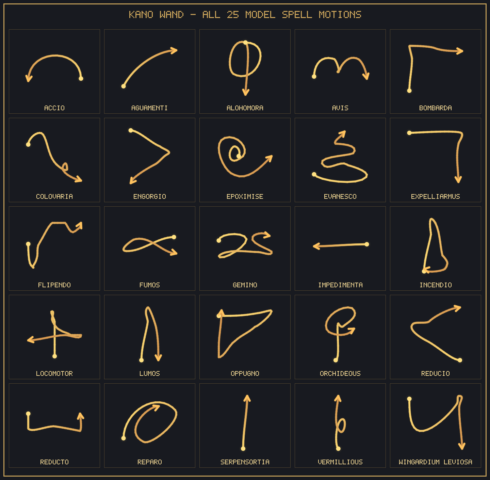

<p align="center">
  <picture>
    <source media="(prefers-color-scheme: dark)" srcset="custom_components/kano_wand/brand/dark_logo@2x.png">
    <source media="(prefers-color-scheme: light)" srcset="custom_components/kano_wand/brand/logo@2x.png">
    
  </picture>
</p>

# Kano Wand — Home Assistant Integration

A custom Home Assistant integration for the **Kano Coding Wand**, built on Home Assistant's native Bluetooth (`habluetooth`) and `bleak-retry-connector` architecture. Supports local Bluetooth adapters and **ESPHome Bluetooth Proxies** so you can cast spells in any room of your home.

---

## ✨ Key Features

- **Multi-Room Bluetooth Proxy Roaming**: Uses `bluetooth.async_register_callback` (`connectable=True`) and `bleak-retry-connector` (`establish_connection` with `BleakClientWithServiceCache`). When the wand wakes up in any room, Home Assistant automatically routes the connection through whichever ESPHome Bluetooth Proxy or local adapter has the strongest RSSI.
- **Sleep-Friendly Lifecycle**: Setup succeeds even while the wand is powered off in a drawer. The integration passively listens for the wand's wake-up advertisement and connects in the background within seconds of pressing the wand button.
- **Dynamic Keep-Alive Timeout Slider**: Configurable slider (`number.kano_wand_keep_alive_timeout`, `0`–`30` minutes) controls how long Home Assistant keeps the wand awake after your last button press before letting it power down and freeing the ESP32 proxy connection slot.
- **High-Frequency GATT Stream Isolation**: Quaternion orientation notifications (`~50 Hz`) are buffered and processed purely in memory while the wand button is held down, avoiding Home Assistant State Machine and Recorder database bloat.
- **Local Neural Network Spell Recognition**: Recognizes 25 Harry Potter spells on-device using pure-NumPy inference over the embedded TFLite model weights, loaded asynchronously in an executor thread so the Home Assistant event loop is never blocked.
- **Full Hardware Control**: Control the wand's onboard RGB tip LED (`light.kano_wand_led`), trigger 7 haptic vibration patterns (`button.kano_wand_vibrate` and `kano_wand.vibrate`), and pause Home Assistant connections at any time with the **Auto Connect** switch (`switch.kano_wand_auto_connect`).

---

## 📦 Installation

### Option 1: HACS (Recommended)
1. Open **HACS** in Home Assistant.
2. Click the three dots in the top-right corner and select **Custom repositories**.
3. Add the URL of this repository with the category **Integration**.
4. Install **Kano Wand** and restart Home Assistant.
5. Turn on your Kano Wand (press the button on the wand)—Home Assistant will automatically discover it under **Settings → Devices & Services**.

### Option 2: Manual Installation
1. Copy the `custom_components/kano_wand` directory into your Home Assistant `<config>/custom_components/kano_wand` folder.
2. Restart Home Assistant.
3. Go to **Settings → Devices & Services → Add Integration** and search for **Kano Wand** (or accept the automatic Bluetooth discovery prompt).

---

## 🧩 Entities Provided

| Platform | Entity ID | Name | Description |
| :--- | :--- | :--- | :--- |
| `event` | `event.kano_wand_spell` | **Spell** | Stateless event entity that triggers on every recognized spell (plus `"recentre"` on a short `<0.35s` button tap). Fires reliably even when casting the exact same spell twice in a row. Attributes: `score`, `duration`, `points`. |
| `event` | `event.kano_wand_flick` | **Flick** | Stateless event entity that triggers on directional wand flicks (`"up"`, `"down"`, `"left"`, `"right"`) when the button is not held down. Attributes: `direction`, `intensity`. |
| `image` | `image.kano_wand_last_spell_drawing` | **Last Spell Drawing** | Poster-styled PNG diagram of the last wand motion path—renders **every** attempt (golden trail for recognized spells, coral-red trail with `CLOSEST: <SPELL> <PCT>%` feedback for unrecognized/practice attempts). |
| `sensor` | `sensor.kano_wand_last_spell` | **Last Spell** | Displays the most recently recognized spell name on dashboards. Attributes: `score`, `duration`, `points`. |
| `sensor` | `sensor.kano_wand_last_spell_confidence` | **Last Spell Confidence** | Confidence score (`%`, `0`–`100%`) of the most recently recognized spell. |
| `sensor` | `sensor.kano_wand_temperature` | **Temperature** | Diagnostic temperature sensor (`°C`) from the wand's onboard IMU. |
| `binary_sensor` | `binary_sensor.kano_wand_button` | **Button** | `on` while the wand button is held down; `off` when released. |
| `binary_sensor` | `binary_sensor.kano_wand_connected` | **Connected** | Diagnostic connectivity sensor (`on` when actively connected to a BLE proxy/adapter). |
| `binary_sensor` | `binary_sensor.kano_wand_battery` | **Battery** | Diagnostic low-battery sensor (`Normal` when `CHAR_BATTERY == 0`, `Low` when `CHAR_BATTERY == 1`, matching the official Kano app). |
| `light` | `light.kano_wand_led` | **LED** | RGB light controlling the LED on the tip of the wand (`ColorMode.RGB`). |
| `select` | `select.kano_wand_vibration_pattern` | **Vibration Pattern** | Choose from all 7 hardware haptic vibration patterns (`regular`, `short`, `burst`, `long`, `short_long`, `short_short`, `big_pause`). Selecting an option previews it immediately if connected. |
| `button` | `button.kano_wand_vibrate` | **Vibrate** | Triggers the currently selected **Vibration Pattern** on the wand. |
| `button` | `button.kano_wand_recentre` | **Recentre Orientation** | Resets the wand's internal quaternion orientation origin. |
| `button` | `button.kano_wand_calibrate_magnetometer` | **Calibrate Magnetometer** | Runs the wand's onboard IMU hardware magnetometer calibration sequence. |
| `button` | `button.kano_wand_disconnect` | **Disconnect** | Immediately disconnects the active BLE session so the wand can sleep right away. |
| `number` | `number.kano_wand_keep_alive_timeout` | **Keep Alive Timeout** | Configuration slider (`0.0`–`30.0` min, step `0.5` min, default `3.0` min) controlling how long the wand stays awake after activity. Persisted across restarts. |
| `number` | `number.kano_wand_min_spell_confidence` | **Minimum Spell Confidence** | Configuration slider (`0%`–`95%`, step `5%`, default `0%`) to ignore accidental low-confidence gestures before firing spell events. Persisted across restarts. |
| `switch` | `switch.kano_wand_auto_connect` | **Auto Connect** | Configuration switch (default `on`). Turn `off` to immediately disconnect Home Assistant from the wand and pause automatic BLE reconnection (e.g., for local PC testing). Persisted across restarts. |
| `switch` | `switch.kano_wand_vibrate_on_connect` | **Vibrate on Connect** | Configuration switch (default `on`) controlling whether the wand vibrates (`burst`) and lights its LED when connecting. |
| `switch` | `switch.kano_wand_vibrate_on_spell` | **Vibrate on Spell** | Configuration switch (default `on`) controlling whether the wand gives a short haptic pulse when a spell gesture is recognized. |

---

## ⚡ Actions / Services

### `kano_wand.vibrate`
Triggers a haptic vibration pattern on one or all connected Kano Wands.

| Field | Type | Required | Default | Description |
| :--- | :--- | :--- | :--- | :--- |
| `device_id` | `string` / `list` | No | All wands | Target Kano Wand device ID(s). |
| `pattern` | `string` / `int` | No | `"regular"` | One of `"regular"` (`1`), `"short"` (`2`), `"burst"` (`3`), `"long"` (`4`), `"short_long"` (`5`), `"short_short"` (`6`), `"big_pause"` (`7`). |

```yaml
action: kano_wand.vibrate
data:
  pattern: burst
```

---

## 🧭 Recentre Orientation vs. Magnetometer Calibration

The Kano Wand contains a 9-axis IMU (accelerometer, gyroscope, and magnetometer) that fuses sensor readings into 3D quaternions. The integration provides two different calibration controls depending on what you need:

### 1. Recentre Orientation (`button.kano_wand_recentre` or Short Button Click)
- **What it does**: Instantly resets the wand's relative quaternion origin (`CHAR_QUATERNIONS_RESET`) so that whichever direction you are currently pointing the wand becomes the center `(400, 300)` of the virtual canvas.
- **When to use it**: Anytime you turn to face a different wall/room, or before practicing a spell. You can trigger it at any time by **short-clicking the physical button on the wand (`<0.35s`)** or pressing **Recentre Orientation** in Home Assistant.

### 2. Calibrate Magnetometer (`button.kano_wand_calibrate_magnetometer`)
- **What it does**: Runs the wand firmware's hardware magnetometer calibration routine (`CHAR_MAGN_CALIBRATE`). It temporarily pauses quaternion streaming, instructs the onboard IMU to sample hard-iron/soft-iron magnetic offsets, waits for the firmware status response, and resumes streaming.
- **When you might need it**:
  - **Sideways drift on `Last Spell Drawing`**: You draw a straight vertical line (like *Serpensortia* or *Lumos*), but the rendered path curves or hooks sideways on its own.
  - **Tilted or skewed axes**: Up/down or left/right wand movements look rotated at an angle on `Last Spell Drawing` even right after recentring.
  - **Magnetic interference or battery change**: The wand was stored near a magnet, speaker, laptop MagSafe charger, or metal desk, or you just replaced the 2× AAA batteries.
- **How to run it**:
  1. Wake the wand so it is connected to Home Assistant.
  2. Press **Calibrate Magnetometer** (`button.kano_wand_calibrate_magnetometer`) in Home Assistant while slowly rotating the wand in a **figure-8** motion in the air for ~3 seconds.
  3. Point the wand comfortably forward and **short-click the wand button once** to recentre the origin.

---

## 🪄 Recognized Spells (25 Spells + Recentre)

The neural network model (`model.tflite`, bit-for-bit identical to the official Kano Coding App's `spelling.weights.bin`) recognizes the following **25 spell gestures** (plus `recentre` on a quick button tap):

<p align="center">
  
</p>

> **Note on the physical box poster (`Stupefy` & `Incendio`)**:
> - Although `Stupefy` was printed on the physical paper poster inside the Kano Wand box, Kano never included `Stupefy` in the official Kano app's neural network (`spelling.json` / `spelling.weights.bin`) or Blockly spell picker.
> - On the physical poster, the triangle motion (Up → Right → Down-Left) is labeled *Incendio*, whereas in the Kano app's neural network that triangle motion is **`Oppugno`**, and **`Incendio`** is a tall narrow flame loop (Up → Down-Right → Left).
> - Both the rendered model training shapes (`docs/spells/*.png`) and the official vector SVGs extracted from the Kano app (`docs/spells/svg/*.svg`) are included in [`docs/spells/`](docs/spells/).

| Spell | Model Shape (PNG) | Official App Icon (SVG) |
| :--- | :--- | :--- |
| `Accio` | [`accio.png`](docs/spells/accio.png) | [`accio.svg`](docs/spells/svg/accio.svg) |
| `Aguamenti` | [`aguamenti.png`](docs/spells/aguamenti.png) | [`aguamenti.svg`](docs/spells/svg/aguamenti.svg) |
| `Alohomora` | [`alohomora.png`](docs/spells/alohomora.png) | [`alohomora.svg`](docs/spells/svg/alohomora.svg) |
| `Avis` | [`avis.png`](docs/spells/avis.png) | [`avis.svg`](docs/spells/svg/avis.svg) |
| `Bombarda` | [`bombarda.png`](docs/spells/bombarda.png) | [`bombarda.svg`](docs/spells/svg/bombarda.svg) |
| `Colovaria` | [`colovaria.png`](docs/spells/colovaria.png) | [`colovaria.svg`](docs/spells/svg/colovaria.svg) |
| `Engorgio` | [`engorgio.png`](docs/spells/engorgio.png) | [`engorgio.svg`](docs/spells/svg/engorgio.svg) |
| `Epoximise` | [`epoximise.png`](docs/spells/epoximise.png) | [`epoximise.svg`](docs/spells/svg/epoximise.svg) |
| `Evanesco` | [`evanesco.png`](docs/spells/evanesco.png) | [`evanesco.svg`](docs/spells/svg/evanesco.svg) |
| `Expelliarmus` | [`expelliarmus.png`](docs/spells/expelliarmus.png) | [`expelliarmus.svg`](docs/spells/svg/expelliarmus.svg) |
| `Flipendo` | [`flipendo.png`](docs/spells/flipendo.png) | [`flipendo.svg`](docs/spells/svg/flipendo.svg) |
| `Fumos` | [`fumos.png`](docs/spells/fumos.png) | [`fumos.svg`](docs/spells/svg/fumos.svg) |
| `Gemino` | [`gemino.png`](docs/spells/gemino.png) | [`gemino.svg`](docs/spells/svg/gemino.svg) |
| `Impedimenta` | [`impedimenta.png`](docs/spells/impedimenta.png) | [`impedimenta.svg`](docs/spells/svg/impedimenta.svg) |
| `Incendio` | [`incendio.png`](docs/spells/incendio.png) | [`incendio.svg`](docs/spells/svg/incendio.svg) |
| `Locomotor` | [`locomotor.png`](docs/spells/locomotor.png) | [`locomotor.svg`](docs/spells/svg/locomotor.svg) |
| `Lumos` | [`lumos.png`](docs/spells/lumos.png) | [`lumos.svg`](docs/spells/svg/lumos.svg) |
| `Oppugno` | [`oppugno.png`](docs/spells/oppugno.png) | [`oppugno.svg`](docs/spells/svg/oppugno.svg) |
| `Orchideous` | [`orchideous.png`](docs/spells/orchideous.png) | [`orchideous.svg`](docs/spells/svg/orchideous.svg) |
| `Reducio` | [`reducio.png`](docs/spells/reducio.png) | [`reducio.svg`](docs/spells/svg/reducio.svg) |
| `Reducto` | [`reducto.png`](docs/spells/reducto.png) | [`reducto.svg`](docs/spells/svg/reducto.svg) |
| `Reparo` | [`reparo.png`](docs/spells/reparo.png) | [`reparo.svg`](docs/spells/svg/reparo.svg) |
| `Serpensortia` | [`serpensortia.png`](docs/spells/serpensortia.png) | [`serpensortia.svg`](docs/spells/svg/serpensortia.svg) |
| `Vermillious` | [`vermillious.png`](docs/spells/vermillious.png) | [`vermillious.svg`](docs/spells/svg/vermillious.svg) |
| `Wingardium Leviosa` | [`wingardium_leviosa.png`](docs/spells/wingardium_leviosa.png) | [`wingardium_leviosa.svg`](docs/spells/svg/wingardium_leviosa.svg) |

---

## 🤖 Automations (Visual Device Automations & YAML)

### 1. Visual Device Automations (Recommended — Zero YAML Required)
Click **+ (Create Automation)** directly on the Kano Wand Device page in Home Assistant to access built-in **Device Triggers**, **Device Conditions**, and **Device Actions**:

- **Device Triggers ("When")**:
  - **Spell cast: `<Spell Name>`** (individual dropdown items for all 25 spells: *Spell cast: Lumos*, *Spell cast: Wingardium Leviosa*, *Spell cast: Incendio*, etc.)
  - **Any spell is cast**
  - **Wand flicked up** / **Wand flicked down** / **Wand flicked left** / **Wand flicked right**
  - **Button short-clicked (Recentre orientation)**
  - **Wand button pressed** / **Wand button released**
  - **Wand connected** / **Wand disconnected**
- **Device Conditions ("And if")**:
  - **Wand is connected** / **Wand is disconnected**
  - **Wand button is pressed**
- **Device Actions ("Then do")**:
  - **Vibrate wand (`Regular` / `Short` / `Burst` / `Long` / `Short-Long` / `Short-Short` / `Big Pause`)**
  - **Turn on wand tip LED** / **Turn off wand tip LED**
  - **Recentre wand orientation**
  - **Calibrate wand magnetometer**
  - **Disconnect wand**

### 2. Triggering on the `event.kano_wand_spell` Entity
Using the `event` entity ensures the automation triggers even if you cast *Lumos* twice in a row:

```yaml
alias: "Kano Wand - Lumos Toggle Living Room Lamp"
triggers:
  - trigger: state
    entity_id: event.kano_wand_spell
    attribute: event_type
    to: "Lumos"
conditions:
  - condition: template
    value_template: "{{ state_attr('event.kano_wand_spell', 'score') | float(0) > 0.60 }}"
actions:
  - action: light.toggle
    target:
      entity_id: light.living_room_lamp
  - action: light.turn_on
    target:
      entity_id: light.kano_wand_led
    data:
      rgb_color: [255, 255, 180]
  - action: kano_wand.vibrate
    data:
      pattern: short
```

---

## 🧪 Local Development & Live BLE Testing

This repository uses [`uv`](https://docs.astral.sh/uv/) for dependency management and local testing on Windows, macOS, and Linux.

### 1. Install Dependencies
```powershell
uv sync
```

### 2. Run Pytest Test Suite
Runs all unit, integration, TFLite gesture recognition, PNG rendering, and metadata tests:
```powershell
uv run pytest
```

### 3. Run Offline TFLite Gesture Model Check
Verifies `ai-edge-litert` model loading and inference speed without needing BLE hardware:
```powershell
uv run python tests/live_ble_test.py --dry-run
```

### 4. Run Live Interactive BLE Test with a Physical Kano Wand
Uses your computer's built-in Bluetooth adapter to scan for the wand, connect via `bleak-retry-connector`, flash the wand's RGB LED, trigger haptic feedback, and print live quaternion stream rates (`~50 Hz`) and recognized spells as you wave the wand:
```powershell
uv run python tests/live_ble_test.py
```

---

## 📁 Repository Structure

```text
├── custom_components/
│   └── kano_wand/
│       ├── model/
│       │   └── model.tflite      # TFLite spell recognition model
│       ├── translations/
│       │   └── en.json
│       ├── __init__.py           # Integration setup, BLE callbacks & services
│       ├── binary_sensor.py      # Button & Connected binary sensors
│       ├── button.py             # Vibrate button entity
│       ├── config_flow.py        # Bluetooth discovery & user config flow
│       ├── const.py              # GATT UUIDs, spells & constants
│       ├── conversion.py         # Quaternion-to-2D Euler projection math
│       ├── drawing.py            # Pure-NumPy poster-styled PNG spell path renderer
│       ├── entity.py             # Base entity & DeviceInfo with BLE connection link
│       ├── event.py              # Stateless Spell EventEntity
│       ├── fitCurves.py          # Cubic Bezier curve fitting for spell paths
│       ├── gesture.py            # TFLite / LiteRT gesture inference
│       ├── image.py              # Last Spell Drawing ImageEntity
│       ├── light.py              # RGB565 Wand Tip LED LightEntity
│       ├── manifest.json         # HA integration manifest & BLE matchers
│       ├── number.py             # Keep Alive Timeout slider (RestoreNumber)
│       ├── sensor.py             # Last Spell sensor
│       ├── services.yaml         # Service definitions for UI
│       ├── strings.json          # UI strings
│       ├── switch.py             # Auto Connect switch (RestoreEntity)
│       └── wand.py               # KanoWand BLE client (bleak-retry-connector)
├── tests/
│   ├── conftest.py               # Shared pytest fixtures & HA test stubs
│   ├── live_ble_test.py          # Interactive CLI live hardware BLE test harness
│   ├── test_config_flow.py       # Bluetooth & user config flow tests
│   ├── test_drawing.py           # Poster PNG renderer tests
│   ├── test_entities.py          # Home Assistant entity & BLE lifecycle tests
│   ├── test_gesture.py           # TFLite spell recognition & fitCurve tests
│   └── test_metadata.py          # Manifest, HACS, translation & brand PNG tests
├── hacs.json                     # HACS repository metadata
├── pyproject.toml                # Project dependencies for uv
└── README.md
```
